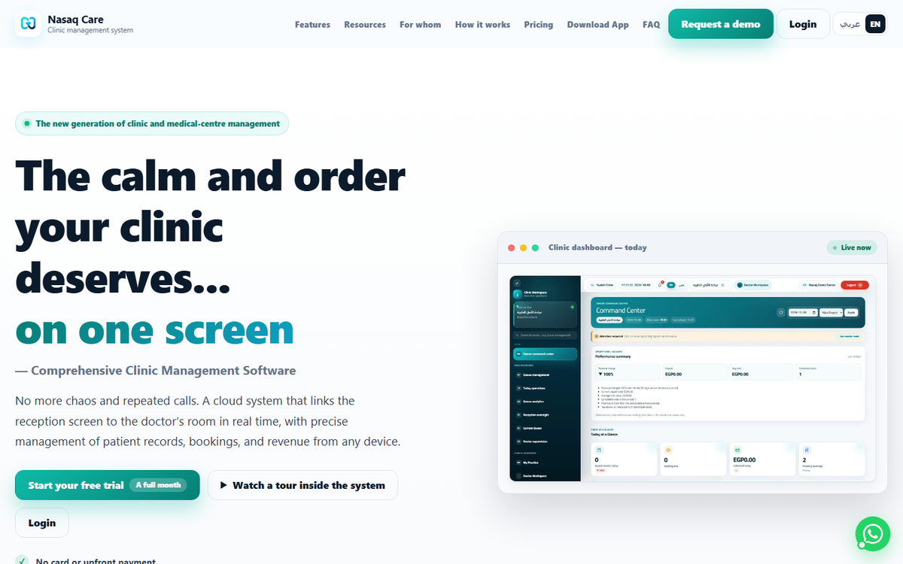
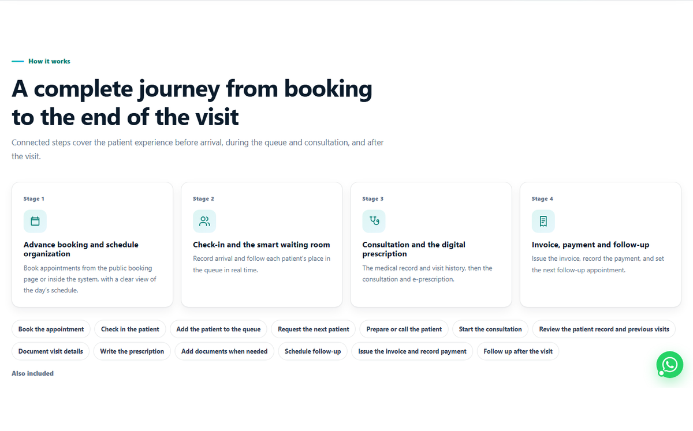
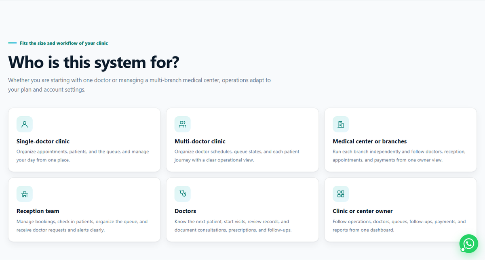
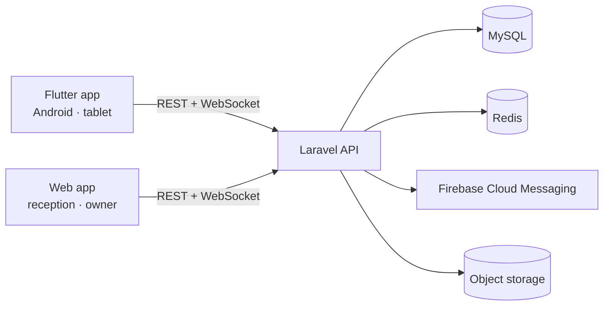

# Nasaq Care — Clinic Management SaaS

**Nasaq Care** is a multi-tenant clinic management platform for clinics, medical centers, and multi-branch practices. It keeps reception, doctors, and owners on the same live picture: appointments, waiting queue, patient records, e-prescriptions, billing, and reporting.

> The source code is private (commercial product). This repository is a product case study: what the system does, how it is built, and the engineering decisions behind it.

## The problem

Clinic teams often run on phone calls, paper, and disconnected tools. Reception loses track of the queue, doctors can't see who's next, owners can't see what's happening across branches, and patients wait without information.

## What Nasaq Care does

- Appointments and a public online booking page
- A live reception-to-doctor waiting queue
- Patient records and visit history
- E-prescriptions
- Invoices, payments, and receipts
- Multi-branch and multi-tenant isolation
- Roles and permissions with audit logging
- Arabic and English with full RTL support
- Operational reports and indicators

## Architecture

- **Multi-tenant isolation** at clinic and branch level
- **Role-based access control** with audit logging
- **Real-time updates** over WebSockets, with polling fallback on weak connections
- **Offline-first** mobile caching for unstable networks
- **Arabic/English** localization with full RTL
- **CI/CD** and automated tests for release safety

## Tech stack

| Layer | Stack |
| --- | --- |
| Mobile | Flutter, Dart, BLoC, go_router, Dio/Retrofit, Hive, Firebase |
| Backend | Laravel, PHP 8.2, MySQL, Redis, WebSockets, Horizon |
| Delivery | Docker, GitHub Actions, Sentry, end-to-end test flows |

## Product links

- Website: [nasaqcare.com](https://nasaqcare.com)
- Android: [Download the latest APK](https://github.com/ahmedsamir10090/nasaqcare-app/releases/latest)

## Role

Founder and lead engineer: product direction, architecture, the Flutter app, the Laravel API, and delivery.

## Contact

- LinkedIn: [ahmed-samir-92b24421b](https://www.linkedin.com/in/ahmed-samir-92b24421b/)
- Email: [ahmedsamir1090a@gmail.com](mailto:ahmedsamir1090a@gmail.com)
